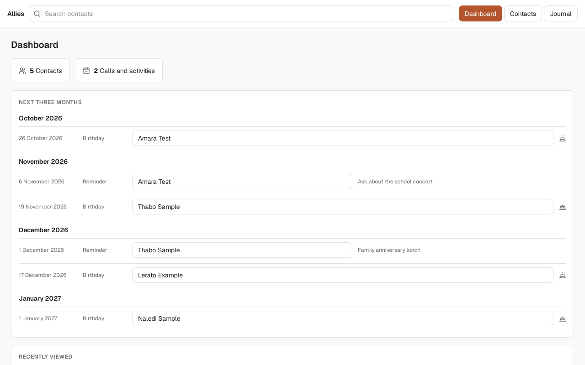
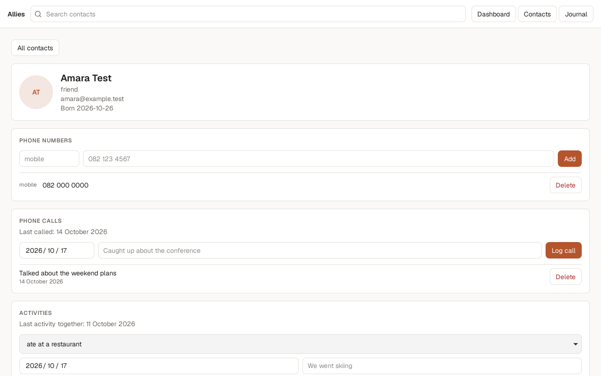
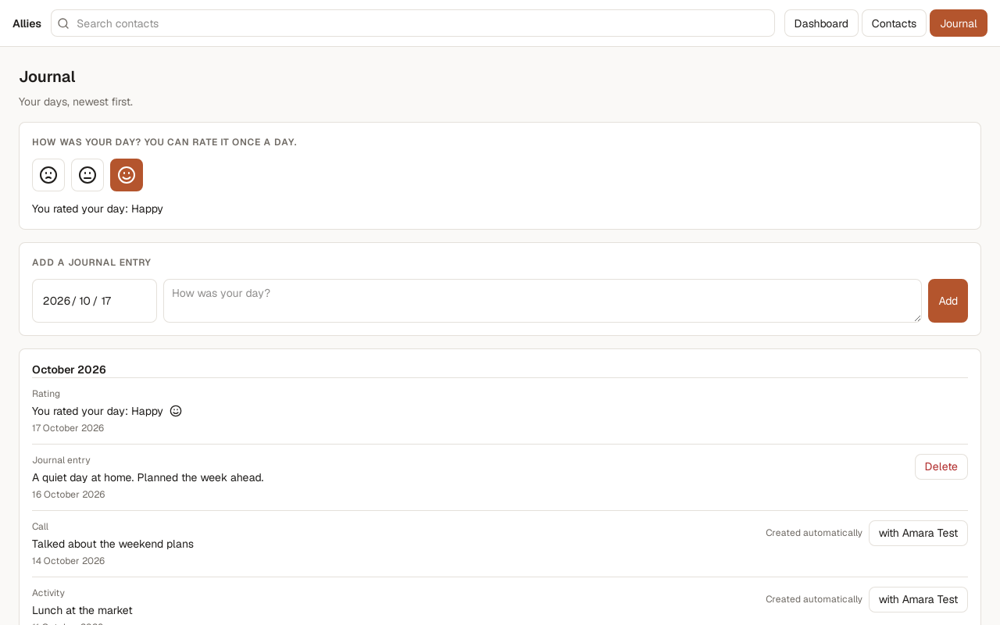

# A desktop app for keeping track of the people who matter to you

17 October 2026 | Issue #1

## What changed
Allies is now a desktop app for Linux that runs on one person's own computer. A dashboard shows the birthdays and reminders coming in the next three months, the contacts the user opened lately, and how many contacts and logged calls and activities there are. Each contact has a page for notes (with favourites), family, phone numbers, addresses, how they met, work, food preferences, tags, tasks, a log of calls and activities, and reminders. A journal holds the user's own entries and one rating per day, and adds an entry by itself whenever a call or activity is logged. A search box at the top finds a contact as the user types.

## Why it matters
It helps one person remember what matters to the people in their life: when a birthday is near, when they last spoke and what is still to follow up. Everything stays on the user's own computer, with no account, no server and no internet connection needed. The earlier web prototype, which needed a server, is replaced.

## Screenshots

