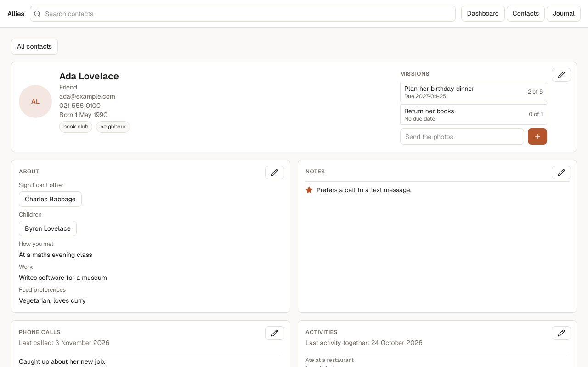
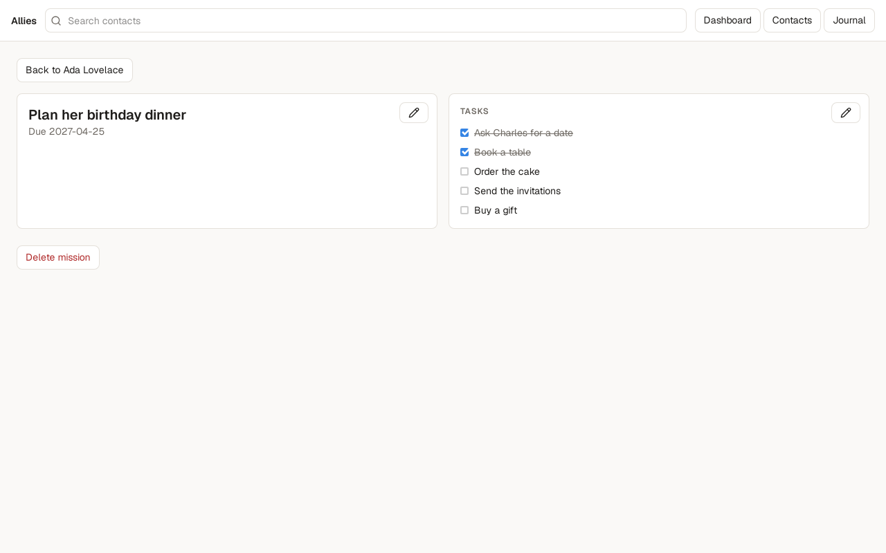

# A clearer contact page, and missions broken into steps

11 November 2026 | Issue #19

## What changed
Each contact's page now shows everything about the person at once. The top of the page holds their picture, name, category, email, phone number, birthday and tags, with their missions on the right. Below that, cards show what you know about them, notes, phone calls, activities, address and reminders. Each card stays read-only until you click its pencil, and a Save button appears only once you change something. A mission now opens on its own screen with a list of tasks you can tick off and put in order, and the contact's page shows how far along each mission is, such as "2 of 5". Categories now start with a capital letter everywhere, and birthdays read as a full date, such as "Born 1 May 1990".

## Why it matters
The user can see a person's whole picture without scrolling through separate forms, and is less likely to change something by accident. Breaking a mission into ordered steps makes it easier to follow through on a plan for someone, such as a birthday dinner, one step at a time. On a narrow window the cards stack in one column in the same order.

## Screenshots

