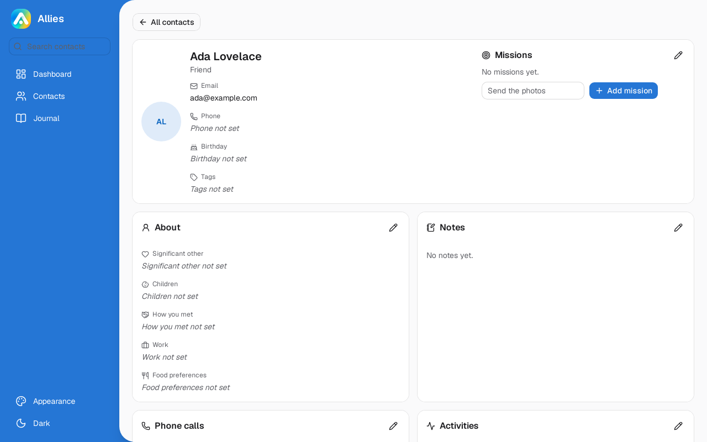
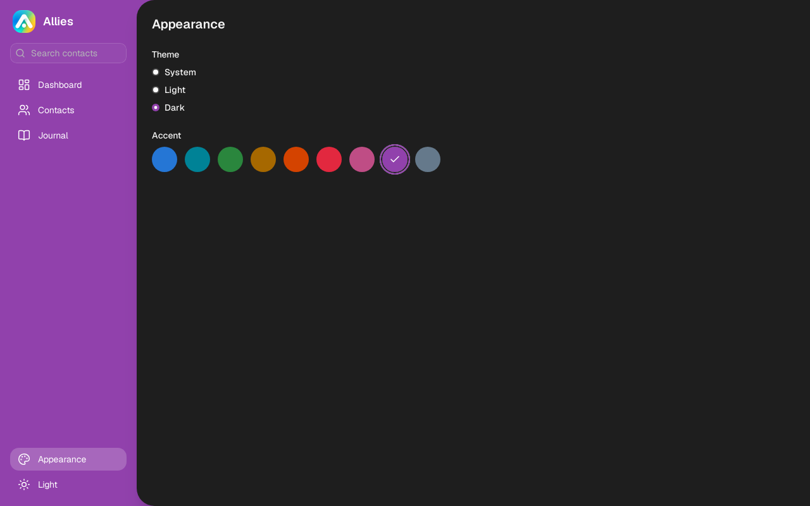
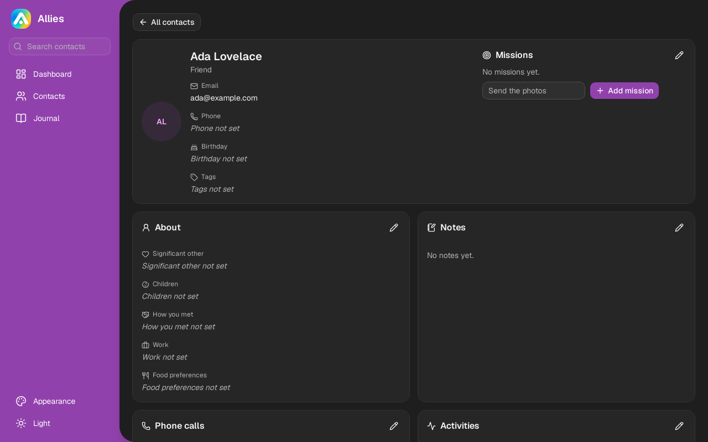

# Light and dark themes, a choice of colour, and a tidier look

13 November 2026 | Issue #26

## What changed
Allies now has a light and a dark theme. It follows the computer's own setting by default, and a button in the sidebar switches between the two. A new Appearance screen offers System, Light or Dark and nine accent colours, the same ones Zaimu uses, and Allies remembers the choice after a restart.

The search box and the screens have moved from a bar along the top to a coloured sidebar on the left. Buttons, rows and other controls change colour when the pointer moves over them, actions carry icons, and every card heading and field label on a contact page has an icon.

## Why it matters
Anyone who uses Allies next to Zaimu and Taskflow gets the same themes, colours and controls in all three apps. It is easier to tell what can be clicked, easier to find a field on a contact page, and easier on the eyes in the evening in the dark theme.

## Screenshots

