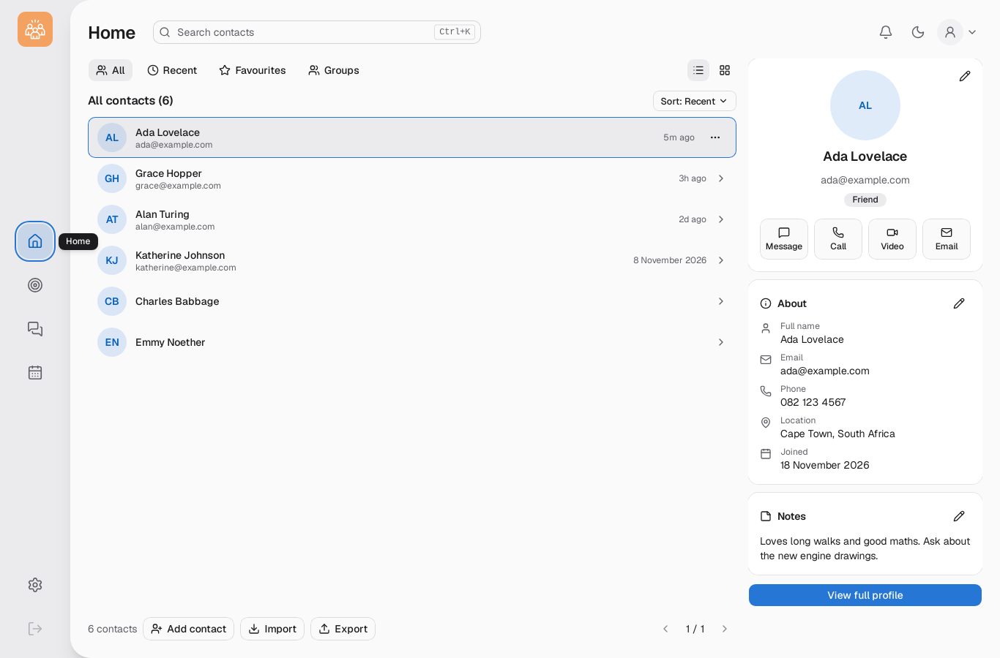
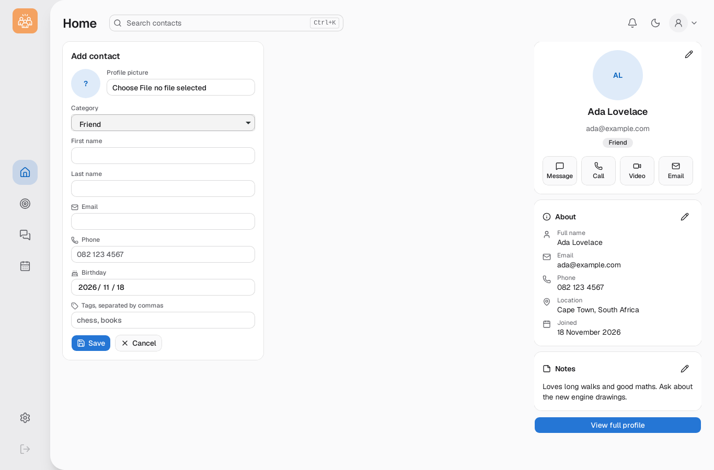

# Home shows your contacts with one person's details beside them

18 November 2026 | Issue #32

## What changed
Home is now a list of your contacts with a panel beside it that always shows one person's details: their picture, email, category, phone, town, the date they were added and their favourite or latest note. Clicking a name in the list shows that person in the panel, and "View full profile" opens their full page. The list puts the people you looked at most recently first and says how long ago that was, such as "5m ago" or "2d ago". It splits into pages that fit the window, so it never needs scrolling. Adding a contact now happens in the list itself, and deleting one has moved to the contact's own page.

## Why it matters
Anyone keeping track of their contacts can see who someone is and read their notes without leaving Home. The people you were dealing with lately are at the top, and pressing Ctrl+K jumps straight to the search box.

## Screenshots

